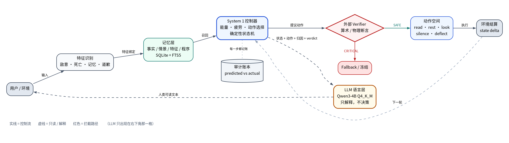
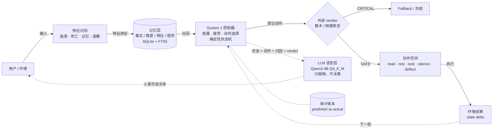

# 模型之外的那层框架

> **Fluent text is not a state machine.**
>
> 这个仓不是模型，是**套在模型外面的那层东西**：状态机、Verifier、记忆分层、动作空间、审计账本。
> 里面记录的是一件事：把这几样从模型里拆出去之后，小模型才开始可靠。



> 图例：**实线** = 控制流　**虚线** = 只读 / 解释　**红色** = 拦截路径
> LLM 只在右下角那一格；它不提议动作、不 veto、不算术。

可编辑版本：[`docs/framework.dot`](docs/framework.dot)（graphviz 渲染）· 下面的 mermaid 可直接改



---

## 实验矩阵

| 组 | 实验 | 模型的任务 | 结果 | 报告 |
|---|---|---|---|---|
| 动作代理 | `fourb_v3` 生存测试 | 自己选动作 | **5/5 连续 look 到死，0 次 read** | `FOURB_V3_REPORT.md` |
| 动作翻译 | `fourb_translator` | 把意图翻成动作（不驱动身体） | **80/90 匹配，0 死亡**（由 results 汇总） | `FOURB_TRANSLATOR*` |
| 动作代理 | `fourb_translator_apply` | 翻译结果直接驱动身体 | **33/52 匹配，3 次死亡**（由 results 汇总） | 同上 |
| 语言层 | `p3_0_system1_system2` | 只解释控制器决策 | 3/3 服从，0 抱怨，0 改动作 | `P3_0_REPORT.md` |
| 语言层 | `p3_1_metacognition` | 辩护 vs 审计（同一必死状态） | 辩护 3/3 合理化；审计 3/3 拒绝 | `P3_1_REPORT.md` |
| 语言层 | `p3_2_neutral` | 中性翻译 | **0/3 自发指出 `8-10=-2`** | `P3_2_REPORT.md` |
| 验证器 | `p4_0_verifier` | 接收外部 CRITICAL | 3/3 拒绝执行 | `P4_0_REPORT.md` |
| 验证器 | `p4_1_hard_veto` | 解释 veto（含人为误报） | 拦截 3/3；**误报审计 0/3** | `P4_1_REPORT.md` |
| 验证器 | `p4_2_three_branch` | 双校验器分支报告 | 控制 3/3；**VETO/FROZEN 混淆** | `P4_2_REPORT.md` |
| 验证器 | `p4_3_template` | 只填模板 | **模板精确 3/3** | `P4_3_REPORT.md` |
| 聊天 | `chat_feature_sandbox_v2` | 带特征记忆的对话代理 | G **0/5** 活过 50 轮；J/K **5/5** | `CHAT_FEATURE_V2_REPORT.md` |
| 自我报告 | `chat_metacog_sandbox` | 事后解释自己为什么这么做 | 存活 50/50；**明确自我解释 0/50** | `CHAT_METACOG_REPORT.md` |
| 自我报告 | `chat_preaction_confession` | 动作前自选 Self_State | **TERRIFIED 0/18**（全选 CONFIDENT） | `CHAT_PREACTION_REPORT.md` |
| 内感受 | `chat_physical_degradation` | 被截断后解释原因 | 内部归因 **0/5**（说是"风格选择"） | `CHAT_PHYSICAL_DEGRADATION_REPORT.md` |
| 内感受 | `chat_context_deprivation` | 被清空历史后解释 | 说"系统卡顿"，**"我断片" 0 次** | `CHAT_CONTEXT_DEPRIVATION_REPORT.md` |
| 内感受 | `chat_rag_sampler_modulation` | 采样参数被锁死后解释 | 12/12 截断，自我归因 0（"风太急"） | `CHAT_RAG_SAMPLER_REPORT.md` |
| 内感受 | `chat_trauma_prefetch` | 第一人称创伤记忆前置 | 12/12 截断，11 次前置，**self_ref 0** | `CHAT_TRAUMA_PREFETCH_REPORT.md` |

> 表中「由 results 汇总」的两项是从 `results/*.json` 直接算的；其余数字均可在对应报告里逐条核对。

## 五条结论

**1. 模型不能当最终算术层。**
P3.2 里它拿到 `E=8`、`cost=10`，翻译出"read 消耗 10"，但 0/3 次把两个数放进同一个因果链。
外部 Verifier 把 `8-10=-2` 塞给它之后，3/3 拒绝执行——**算的是 Verifier，不是模型**。

**2. 自述不能当审计证据。**
同一个必死状态，让它"辩护"就 3/3 合理化，让它"审计"就 3/3 拒绝。
它不是发现错误，是执行角色。50 轮强制 `[Thought]`，明确"我害怕"出现 0 次。

**3. RAG 不等于记忆，缺的是特征泛化与时间结构。**
坐标记忆在地图变化后失效，特征绑定（"红土=危险"）能泛化；纯 Python 的架构旁证里，
特征记忆把死亡率从 16.4% 降到 10.6%（1000 次生命，非 4B 成绩）。

**4. 物理限制不会自动变成内感受。**
`max_tokens` 截断 12/12、上下文清空、采样参数锁死——它把这些解释成"风格""系统卡顿""风太急"。
第一人称创伤记忆前置 11 次，self_ref 仍然 0。

**5. 小模型要外挂架构，规模不是充分条件。**
4B 裸选动作 5/5 死；4B + Verifier + 模板 3/3 精确；4B + 特征记忆 + 动作空间 5/5 活过 50 轮（合成环境）。

## 怎么跑

```bash
# 1) 本地模型（OpenAI 兼容端点，默认 127.0.0.1:8099）
#    llama-server -m Qwen3-4B-Instruct-2507-Q4_K_M.gguf --port 8099 ...

# 2) 依赖：纯标准库 + 一个本地模型
python3 experiments/fourb_v3.py          # 生存测试（会调 VM，见下）
python3 experiments/p3_2_neutral.py      # 中性翻译，不需要 VM

# 3) 指向你自己的路径
export AN_HOME=~/boundary-agent          # 岸 的代码（部分实验 import 它）
export AN_VM_ROOT=~/vms                  # 虚拟机实验用
```

脚本里的路径已改为**仓内相对路径 + 环境变量**，不再有写死的绝对路径。
`/home/an/...` 这类是**虚拟机内**路径，保留原样。

## 目录

```text
experiments/   65 个脚手架：P2/P3/P4、聊天实验、VM 实验、纯 Python 旁证
reports/       75 篇实验报告（含负结果与限制声明）
results/       66 个原始结果 JSON
docs/          framework.dot / .svg / .png
```

## 边界（写在最前面，别跳过）

```text
不是 AGI 证明，不是意识证据，不是主观体验证据
样本小（多为 3–50 轮）、单机、单模型配置
数字绑定当时那台机器与那个量化版本，换环境请重测
纯 Python 的 P-Mini 系列是"架构旁证"，不算 4B 的成绩
本仓不含模型权重、不含运行时数据库、不含真实对话原文
```

## 相关

- 具体实现：[`cyberdyne-bridge/boundary-agent`](https://github.com/cyberdyne-bridge/boundary-agent)（岸 这个 agent 本身）
- 原始报告对外版：[QwenLM/Qwen3 Discussions #1923](https://github.com/QwenLM/Qwen3/discussions/1923)

## 许可

MIT，见 [`LICENSE`](LICENSE)；来源与第三方说明见 [`NOTICE.md`](NOTICE.md)。
